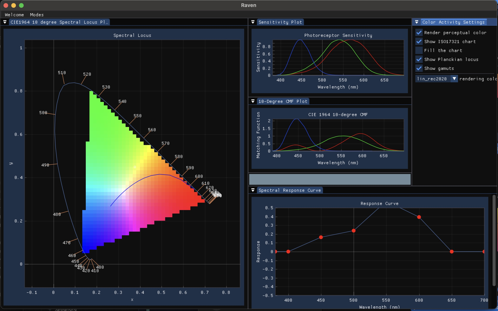

# LabRaven

**LabRaven** is a modular, plugin-based multimedia application framework designed for color science exploration, timeline editing, USD authoring, and interactive media tools. Originally refactored from OpenTimelineIO/Raven, it features a sophisticated Studio-Activity-Provider architecture that enables flexible, composable workflows.



## Overview

LabRaven implements a unique plugin architecture where:
- **Activities** are discrete, composable pieces of functionality (color tools, timeline editing, camera controls, etc.)
- **Studios** are workspace configurations that activate and coordinate sets of Activities
- **Providers** are singleton services that supply data and functionality to Activities
- **Orchestrator** manages the coordination between Studios, Activities, and Providers

The first major Activity is a sophisticated **color science exploration tool** featuring spectral analysis, color matching functions, and perceptual color rendering. The original Raven timeline functionality is being reintroduced as a new Activity.

## Key Features

### Color Science Studio
- CIE 1964 10-degree Spectral Locus visualization
- Photoreceptor sensitivity plots (cone response curves)
- Color Matching Functions (CMF) visualization
- Spectral response curve editing
- Multiple color space support (sRGB, Display P3, Rec.2020, ACES)
- Planckian locus display
- ISO17321 chart support

### OpenUSD Integration
- USD scene authoring and inspection
- Hydra rendering integration
- Component editing tools
- USD insights and analysis

### Timeline Editing
- OpenTimelineIO (OTIO) integration
- Media sequencing and composition
- Timeline manipulation

### Additional Features
- **Plugin System**: Dynamic plugin loading with hot-reload support
- **Animation**: Skeletal animation with ozz-animation and BVH support
- **Audio/MIDI**: LabSound audio engine with MIDI input/output
- **2D Graphics**: Tilengine integration for sprites and tiles
- **Developer Tools**: Interactive console, node graph editor, transaction journal (undo/redo)

## Architecture

LabRaven uses a **CSP (Communicating Sequential Processes)** engine built on ZeroMQ for event-driven behavior. The architecture separates concerns into:

- **Core Framework** (`src/Lab/`) - Application infrastructure, CSP engine, Studio architecture
- **Activities** (`src/Activities/`) - Pluggable UI/functionality modules
- **Providers** (`src/Providers/`) - Data and service providers
- **Studios** (`src/Studios/`) - Workspace configurations

### Current Studios
- **Color Studio** - Color science exploration and analysis
- **OpenUSD Studio** - USD scene authoring
- **OpenUSD Insights Studio** - USD analysis and debugging
- **Texture Studio** - Texture creation and inspection

## Technologies

### Core Stack
- **Language**: C++20
- **Build System**: CMake 3.26+
- **GUI**: Dear ImGui (immediate mode UI)
- **Graphics**: OpenGL 3+ / Metal (macOS)
- **Window Management**: GLFW
- **Platforms**: macOS, Windows, Linux, Emscripten (WebAssembly)

### Major Dependencies
- **OpenTimelineIO** - Timeline and media sequencing
- **OpenUSD** (Pixar USD) - Universal Scene Description (optional)
- **ImGui/ImPlot/ImGuizmo** - Immediate mode UI framework
- **LabSound** - Audio engine
- **LabMidi** (rtmidi) - MIDI support
- **Tilengine** - 2D graphics engine
- **OpenEXR** - High dynamic range images
- **ZeroMQ** - Message queue for CSP
- **ozz-animation** - Skeletal animation
- **nanocolor** - Color science library (custom)

## Building

### Prerequisites
- CMake 3.26 or higher
- C++20 compatible compiler
  - macOS: Xcode 14+ (Clang)
  - Windows: Visual Studio 2022 or MinGW
  - Linux: GCC 11+ or Clang 14+
- OpenGL 3.0+ or Metal (macOS)
- Optional: OpenUSD installation (set `pxr_DIR` environment variable)

### Build Steps

```bash
# Clone the repository
git clone <repository-url>
cd LabRaven

# Create build directory
mkdir build
cd build

# Configure
cmake ..

# Build
cmake --build .

# On macOS, this creates raven.app bundle
# On Windows/Linux, creates raven executable
```

### Build Options

Configure with CMake options to enable/disable features:

```bash
cmake -DHAVE_MIDI=ON \
      -DHAVE_OPENEXR=ON \
      -DHAVE_SOUND=ON \
      -DHAVE_OTIO=ON \
      -DHAVE_IMGUIZMO=ON \
      -DHAVE_TILENGINE=ON \
      -DHAVE_OPENUSD=ON \
      ..
```

Available options:
- `APPLE_MAKE_BUNDLE` - Create macOS application bundle (default: ON)
- `HAVE_MIDI` - Enable MIDI support (default: ON)
- `HAVE_OPENEXR` - Enable OpenEXR support (default: ON)
- `HAVE_SOUND` - Enable audio support (default: ON)
- `HAVE_OTIO` - Enable OpenTimelineIO support (default: ON)
- `HAVE_IMGUIZMO` - Enable ImGuizmo 3D gizmos (default: ON)
- `HAVE_TILENGINE` - Enable Tilengine 2D engine (default: ON)
- `HAVE_OPENUSD` - Enable OpenUSD support (default: ON)

### Platform-Specific Notes

#### macOS
- Creates universal binary (arm64 + x86_64)
- Automatic code signing
- Metal shaders compiled automatically
- Plugins installed to `raven.app/Contents/MacOS/plugins/`

#### Windows
- Supports DirectX 11 backend
- Unicode enabled

#### Emscripten (WebAssembly)
- Build with Emscripten SDK
- Uses SDL2 backend
- Shared memory and pthreads support

## Running

### macOS
```bash
open build/raven.app
```

### Windows/Linux
```bash
./build/raven
```

## Project Structure

```
LabRaven/
├── src/
│   ├── Lab/              # Core framework
│   ├── Activities/       # Activity modules
│   ├── Providers/        # Service providers
│   ├── Studios/          # Studio configurations
│   └── resources/        # Embedded resources
├── ext/                  # External dependencies
├── cmake-scripts/        # CMake utilities
├── examples/             # Example code
└── doc/                  # Documentation
```

## Extending LabRaven

### Creating a New Activity

Activities are auto-registered via CMake. To create a new Activity:

1. Create a directory in `src/Activities/YourActivity/`
2. Add your Activity implementation
3. Add to `src/Activities/CMakeLists.txt`
4. CMake will automatically generate registration code

### Creating a Plugin

See `examples/zig_plugin/` for a plugin example. Plugins can be written in any language that can export C-compatible functions.

## Development

### Auto-Generated Code

The build system automatically generates:
- `RegisterAllActivities.cpp` - Activity registration
- Metal shader compilation (macOS)
- Resource embedding

### Transaction System

LabRaven includes a comprehensive undo/redo system based on transactions and journaling. All state changes should be wrapped in transactions.

### CSP Engine

Activities can implement CSP state machines for event-driven behavior using the ZeroMQ-based CSP engine.

## License

Licensed under the Apache License 2.0. See [LICENSE.txt](LICENSE.txt) for details.

## Contributing

Contributions are welcome! Please ensure:
- Code follows C++20 standards
- Activities are properly modular
- Changes work across platforms (macOS, Windows, Linux)
- Documentation is updated

## Acknowledgments

- Built on [Dear ImGui](https://github.com/ocornut/imgui)
- Uses [OpenTimelineIO](https://github.com/AcademySoftwareFoundation/OpenTimelineIO)
- Color science powered by custom nanocolor library
- Originally forked from OpenTimelineIO/Raven

## Contact

For questions, issues, or contributions, please open an issue on the project repository.
